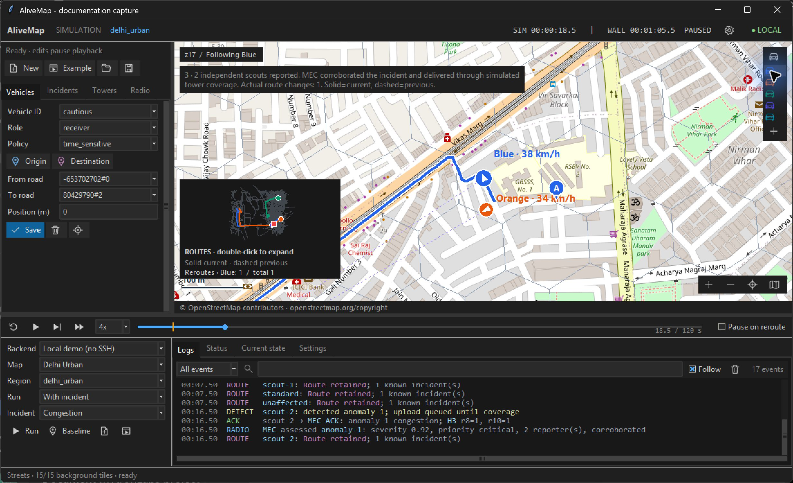
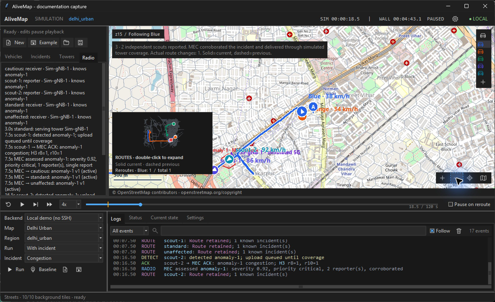
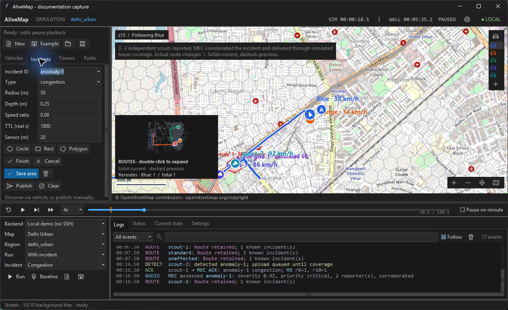
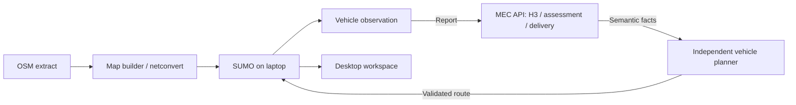

# AliveMap

An interactive autonomous-routing research playground built with SUMO, TraCI,
OpenStreetMap and H3. Vehicles observe synthetic road incidents, report them to
an edge service, receive relevant semantic updates, and independently plan routes.

[Quick start](#run-locally) · [Setup guide](docs/setup.md) · [Workspace](docs/workspace.md) · [Results](docs/results.md)



*An actual local Delhi run, paused after two independent scout reports and a
receiver reroute. Map © OpenStreetMap contributors. [Image details](docs/images/README.md).*

**Status:** working research proof of concept, tested on Windows 11 / Python 3.12.
Local simulation needs no MEC account, SSH tunnel or Cloudflare subscription.
Physical-MEC integration is optional. Tower coverage is simulated; actual 5G
radio and user-plane transport have not been verified.

## Run locally

On Windows 11, install **Git** and **Python 3.12 with Tcl/Tk** first. Then paste
this into PowerShell:

```powershell
git clone https://github.com/aishwary2316/AliveMap.git
cd AliveMap
powershell -NoProfile -ExecutionPolicy Bypass -File .\Setup.ps1
```

**Already cloned? Run just the last command.** It creates `.venv`, installs pinned
dependencies, builds a real Delhi road package, checks two independent reports
and routing in actual SUMO, checks the same trips without an incident, then opens
the workspace. No admin privileges, credentials or physical MEC are needed.
The execution-policy option applies only to this PowerShell process.

First setup downloads packages and OSM data; allow several minutes and Internet
access. Rerunning reuses the environment and validated map packages. It never
deletes an existing environment or overwrites remote services.

| Setup | Command after cloning |
| --- | --- |
| Delhi, verify and launch | `powershell -NoProfile -ExecutionPolicy Bypass -File .\Setup.ps1` |
| All four map regions | `powershell -NoProfile -ExecutionPolicy Bypass -File .\Setup.ps1 -AllMaps` |
| Include elevation/imagery acquisition | Add `-Terrain` |
| Install without opening a window | Add `-NoLaunch` |
| Development tools | Add `-Dev` |

The default roads-only package is explicitly marked degraded for raster data;
the real road network and incident routing work. `-Terrain` attempts optional
DEM/historical imagery downloads. Source outages are reported. Large generated
assets stay outside Git. See [complete setup, Linux and recovery steps](docs/setup.md).

Select **Local**, **Delhi Urban**, and **With incident**, then Run/Play. Two scouts
independently encounter the anomaly. Their reports update the local MEC
implementation; receiving vehicles compute new routes. Solid coloured lines show
current routes; dashed segments show retired routes. Select **Without incident**
and run again to compare the same initial trips. An impossible detour produces
a safe stop rather than an invented route.

After installation, **Open AliveMap Playground.cmd** opens the same workspace.
See the [workspace guide](docs/workspace.md) for editing and vehicle tracking.

## Features

- Real directed OSM networks in Delhi, coastal Gujarat and two Manipur subregions.
- Independent vehicle routes using road permissions, incident geometry and policy.
- Editable roles, origin/destination pins, circle/rectangle/polygon anomalies.
- H3 resolution 8/10 processing, report corroboration and scoped delivery.
- Streets/terrain display, tracking, route history, clocks and speed controls.
- Local backend and optional authenticated HTTPS MEC with persistent state.

| Inspect report delivery | Build your own scenario |
| --- | --- |
|  |  |
| Follow report acknowledgements and each vehicle's received facts. | Draw an area, set its properties, save ground truth or publish explicitly. |

Both views are from the same actual local run. Towers and incidents are
synthetic; the roads and street background are OSM-derived.

## How it works



The edge service sends facts, not prescribed routes. Local mode executes the
same API logic in-process. Remote mode uses authenticated HTTPS to your own
service. See [architecture](docs/architecture.md) and [deployment](docs/permanent-deployment.md).

## Verification

The publication verification on **4 November 2026 passed all 88 tests in one
full Windows run**. A source-only snapshot also passed 48 portable checks, and
a freshly downloaded Delhi map passed the two-scout/incident-free comparison.
Four real-map stories demonstrate independent reports and rerouting or a
legitimate no-route stop. These synthetic results are not field incident
detection or 5G latency results.
See [results and limitations](docs/results.md).

```powershell
.\.venv\Scripts\python.exe -m pip install -r requirements-dev.txt
.\.venv\Scripts\python.exe -m pytest -m "not gui and not maps" -q
.\.venv\Scripts\python.exe -m pytest -q
```

The first test command excludes native windows and geographic integration.
The full suite includes real SUMO and Tk; map-dependent tests skip until assets
are built. See [testing](docs/testing.md).

## Documentation

| Guide | Contents |
| --- | --- |
| [Setup](docs/setup.md) | One-command installation, repeat runs and replication |
| [Workspace](docs/workspace.md) | Controls and scenario editing |
| [Maps](docs/map-system.md) | Build regions, provenance, terrain limits |
| [Architecture](docs/architecture.md) | Processing, messages, module boundaries |
| [MEC API](docs/playground-api.md) | Typed endpoints, reports and assessments |
| [Software reference](docs/software-reference.md) | Dependencies, data providers and source modules |
| [Routing model](docs/routing-model.md) | Cost equations, profiles and incident effects |
| [Configuration](docs/configuration.md) | Launchers, private settings, scenes and run files |
| [Troubleshooting](docs/troubleshooting.md) | Startup, maps, reports, routing and connection problems |
| [Results](docs/results.md) | Dated evidence and reproducible experiments |
| [Deployment](docs/permanent-deployment.md) | Optional managed MEC integration |
| [Contributing](CONTRIBUTING.md) | Development, tests, pull requests |
| [Third-party notices](THIRD_PARTY_NOTICES.md) | Code and data attribution |
| [Security](SECURITY.md) | Private configuration and reporting |
| [Release preparation](docs/releasing.md) | Remaining publication decisions |

Older grid controllers and semantic-view tools remain compatibility diagnostics.
The superseded prototype is described in the [archive index](experiments/standalone-poc/README.md).

## Limitations

Incident geometry, sensor reach and circular tower coverage are simulated.
Severity/confidence use POC rules, not calibrated safety models. DSM terrain is
approximate; routing costs do not model flood dynamics. Public tiles and WAN
services can be unavailable; playback speed is not a guaranteed real-time factor.
Linux desktop support has not received the same native UI verification as Windows.
